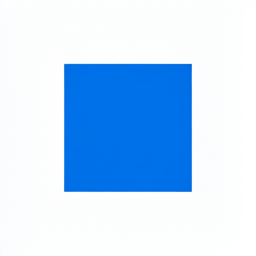

# Continuazione Metal: replay BF16 e reference RGBA

29 ottobre 2026, M5 Pro 24 GiB, sorgenti iniziali `5fc8229`. Stato
`IN_PROGRESS`. [verification.json](verification.json) conserva comandi,
hash, memoria ed esiti; i report precedenti non sono stati sovrascritti.
Questa sessione non cambia kernel numerici o tolleranze.

## Gemma: prima divergenza isolata

`tools/diagnose_gemma_metal_bf16.py` legge soltanto i due tensori PLE e le
trace di due testi di 8 e 7 token. Ripete separatamente GEMM, scala e RMSNorm
su input identici, senza caricare il modello completo. Il confronto FP64
ricalcola soltanto i prodotti scalari divergenti. Il ledger impone un cap di
1 GiB con riserva host di 2 GiB: picco numerico 38.363.136 byte, storage
finale nullo. [bf16-diagnosis.json](bf16-diagnosis.json) distingue il successo
del replay dal gate numerico stretto, ancora **FAIL**.

| Confine | Testo 0, 98.304 valori | Testo 1, 86.016 valori |
| --- | ---: | ---: |
| GEMM, stesso input BF16 | 14 differenze | 11 differenze |
| RMSNorm, stesso input della CPU | 2 differenze | 1 differenza |
| Scala, stesso input | 0 differenze | 0 differenze |
| PLE completa | 17 differenze | 11 differenze |
| Replay contro trace del proprio backend | 0 differenze | 0 differenze |

Nei 25 prodotti scalari divergenti, la CPU è più vicina alla somma FP64 in
14 casi e Metal in 11. Le differenze iniziano nell'accumulo FP32 e nei casi
vicini alle frontiere BF16; non dimostrano un decoder BF16 errato o la
superiorità sistematica di uno dei due backend. La diagnosi non chiude il
gate bit-exact né giustifica l'allargamento delle soglie. Rimangono da
triangolare le altre primitive e le frontiere multimodali.

Il modello Gemma reale è stato rieseguito su entrambi i testi: due replay
identici, cancellazione/riprova, dimensione invalida e budget insufficiente
passano in 7,09 s con la riserva host aggiornata. Il replay isolato riproduce
esattamente le nuove trace.
I tre test del diagnostico verificano ties-to-even, NaN, cancellazione
numerica e rifiuto di trace troncate o troppo grandi.

```sh
make -j2 tests/libds4_numeric_metal.so tests/probe_native_suite
build/metal-venv/bin/python -m unittest tests.test_gemma_bf16_diagnostic -v
build/metal-venv/bin/python tools/diagnose_gemma_metal_bf16.py \
  --model build/metal-oracles/models/google/embeddinggemma-2/model.safetensors \
  --native build/metal-qualification/bf16-live-final-20261029 \
  --oracle build/metal-qualification/gemma-text-oracle \
  --output build/metal-qualification/bf16-replay-new
```

## Qwen Image: editing con reference RGBA reale

Una reference 256×256 con 16 livelli alpha, prompt «Change the red square to
blue; keep the background white.», seed 20261029, otto passi, CFG 1 e profilo
`bf16-native-v1`. Nessun ridimensionamento implicito. Il preflight ammette
4.015.333.752 byte device e 148.262.832 byte host. Il probe usa un limite
device di 4 GiB; il factory comune dei probe Metal conserva ora anche la
riserva host di 2 GiB prevista dalla roadmap.

La pipeline completa passa: VAE encoder, conditioning, otto passi DiT e VAE
decoder. Tempo totale del processo 243,77 s, apertura inclusa; pipeline
161,36 s. Picco numerico 3.977.325.216 byte, **3,70 GiB**, sotto il piano;
storage numerico finale zero. Tutti gli otto latenti e l'output sono finiti.
PNG RGBA 256×256, valori in [0,1], alpha in [0,994140625,1]. Il prompt chiede
uno sfondo bianco: questo caso non qualifica la generazione trasparente.




L'ispezione mostra il quadrato blu con geometria conservata e fondo bianco,
senza artefatti evidenti. Il conditioning è bit-exact rispetto alla precedente
reference RGB che produce gli stessi pixel dopo compositing su bianco; il
VAE riceve invece l'alpha e produce latenti della reference differenti.
Questo controllo collega i due rami della recipe, ma non sostituisce un
oracle indipendente della pipeline completa.

Il campione massimo RSS è 8,19 GiB: mapping, driver e altro overhead sono
distinti dai 3,70 GiB numerici. Il minimo campionato di memoria libera
riportato da `memory_pressure -Q` è 37%; lo swap cresce al massimo di
0,32 MiB e termina inferiore al valore iniziale. Nessun timeout, arresto
forzato o pubblicazione parziale. [rgba-run.json](rgba-run.json) conserva i
campioni; [rgba-runtime.json](rgba-runtime.json) conserva piano e fasi.
La matrice completa dei guasti image non è stata eseguita in questo run.

Il venv locale aveva Pillow 13.0.0: due forti riduzioni divergevano dal
preprocessing fissato a 12.3.0. Riallineato il solo venv locale alla versione
già prescritta in `tests/requirements-suite.txt`, usando la cache offline,
i test Lanczos RGB/RGBA passano. Nessuna modifica al preprocessore C.

```sh
make -j2 tests/probe_qwen_image_pipeline tests/libds4_suite_metal.so
DS4_SUITE_CPU_LIBRARY=tests/libds4_suite_metal.so \
  build/metal-venv/bin/python -m unittest tests.test_qwen_image_reference -v
DS4_SUITE_CASES_ONLY=1 DS4_SUITE_DEVICE_LIMIT=4294967296 \
  ./tests/probe_qwen_image_pipeline \
  build/metal-models/image-bf16.ds4b/bundle.ds4b build/metal-models \
  build/metal-models/image-tokenizer.ds4q \
  build/metal-qualification/rgba-20261029/new-native \
  build/metal-qualification/rgba-20261029/edit-rgba.ds4pip
```

La fixture e il suo SHA sono nel registro; deriva dal caso RGB conservando
prompt, seed e rumore. Il canale alpha è nullo fuori da `[32:224,32:224]`,
255 all'interno, con rampe verticali di 16 righe ai bordi superiore/inferiore.
I test host mirati sono cinque, tutti PASS. Build ordinaria e suite PASS.
F02/F03 restano aperti per oracle image, alpha/qualità estesi e Files/HTTP.

## S1 Qwen Image: riferimenti prima dei prossimi kernel

Snapshot consultati, senza importare codice nel prodotto:

- [Transformers, Qwen3-VL](https://github.com/huggingface/transformers/blob/d4fcbccd0966ace9505b9cbd3041d28ad822d8a7/src/transformers/models/qwen3_vl/modeling_qwen3_vl.py),
  Apache-2.0. RMSNorm testo: riduzione FP32, arrotondamento al dtype in ingresso
  prima del peso; RoPE vision calcolata in FP32 e ricondotta al dtype originale;
  softmax FP32. L'adapter image conserva queste frontiere, differenti da Gemma.
- [llama.cpp/ggml Metal](https://github.com/ggml-org/llama.cpp/tree/0893ec98f5eafad36a43a72cd1c3723d72b0d03a/ggml/src/ggml-metal),
  MIT. `kernels/mul_mm.metal` ha `kernel_mul_mm_bf16_f32`, staging bfloat e
  accumulo FP32, con gate `GGML_METAL_HAS_BF16`; `common.h` richiede almeno
  MSL 3.1. Sono candidati riusabili il tiling, il controllo delle code K,
  l'allineamento e gli offset a 64 bit. Non sono binding direttamente
  intercambiabili con l'API numerica della suite. `norm.metal` opera su F32:
  una fusione non deve cancellare le frontiere BF16 del modello. I percorsi
  im2col consultati producono F32/F16; non costituiscono un VAE BF16 pronto.
- [Diffusers DiT](https://github.com/huggingface/diffusers/blob/aea7b70be0f594bcdc15a6f2677ee2ca85e49e8e/src/diffusers/models/transformers/transformer_qwenimage21.py),
  [VAE](https://github.com/huggingface/diffusers/blob/aea7b70be0f594bcdc15a6f2677ee2ca85e49e8e/src/diffusers/models/autoencoders/autoencoder_kl_qwenimage21.py)
  e [pipeline](https://github.com/huggingface/diffusers/blob/aea7b70be0f594bcdc15a6f2677ee2ca85e49e8e/src/diffusers/pipelines/qwenimage21/pipeline_qwenimage21.py),
  Apache-2.0. Confermati RoPE complessa in FP32, norm centrata su zero,
  modulazioni, convoluzioni causali e ordine del timestep:
  `t.expand(...).to(latents.dtype)` prima della divisione per 1000.

[llama-sources.json](llama-sources.json),
[transformers-sources.json](transformers-sources.json) e
[diffusers-sources.json](diffusers-sources.json) conservano file, commit e SHA.
Nel tree llama.cpp consultato non emergono path dedicati a Qwen Image;
il grafo Qwen3-VL e le primitive Metal non dimostrano copertura DiT/VAE.
Questo è un riesame statico S1: nessun kernel nuovo o speedup qualificato.
Il prossimo esperimento deve confrontare il GEMM BF16 nativo con MPS su
shape encoder/DiT identiche, controllando numerica, code, memoria e capability,
prima del tuning e dell'integrazione S2–S4.

## Limiti ancora vincolanti

Qwen27 target-only, contesto 256/prefill 64, è rifiutato prima del caricamento:
richiesti 14,76 GiB, disponibili 9,42 GiB dopo riserva di 2 GiB. Flash GGUF
principale ancora assente, download dell'utente in corso. Non sono stati
eseguiti inferenza LLM, alternanza suite/LLM, MTP/vision LLM, client ExMekh,
nuovi gate HTTP, CUDA/ROCm o altre famiglie Apple. Il piano non è completo.
