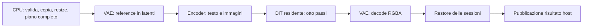

# T11–T12: pipeline image e backbone testuale Gemma

API C per Qwen Image 2.1 Turbo e il backbone testuale EmbeddingGemma 2,
profilo `bf16-native-v1`, Linux/WSL e RTX 3090 `sm_86`. Python/PyTorch,
Transformers e Diffusers sono strumenti offline. Inferenza nativa con CUDA,
cuBLAS/cuBLASLt e cuDNN; nuovi endpoint HTTP e Gemma image/video/audio restano
nei task successivi. Esiti, hash e fonti sono in `verification.json` e
`provenance.json`; dump/log conservati in
`performance-results/native-suite-t11-t12-20261021/`.

## Percorso scelto e registro delle prove

Il percorso BF16 scelto mantiene il DiT interamente in GPU per gli otto passi,
usa la prefix K/V su GPU quando ammessa e separa Q/K/V vision con tre reorder
per layer. Encoder, DiT e VAE si alternano secondo il piano completo della
richiesta. La cache K/V host è un fallback di capacità con gli stessi valori
BF16; non è la prima scelta quando la cache GPU entra. Non sono introdotte
approssimazioni DiT, riduzioni dei passi o quantizzazioni per ottenere velocità.

| Prova / modifica | Risultato osservato | Decisione e limite |
| --- | --- | --- |
| Tre reorder Q/K/V invece delle copie per patch | Mediana encoder caldo 9,3274 → 0,87195 s, cinque campioni per variante; 84 dump BF16 identici | Mantenuta; 10,70× sul solo encoder, caricamento escluso |
| Piano DiT proporzionato ai buffer vivi | Il caso 1024×1536 con due reference 1184×896 entra con K/V GPU, senza vittime; picco posseduto 20,7–21,3 GiB nei due seed | Mantenuto; riduce la prenotazione superflua, non i byte dei pesi |
| Cache K/V host | Caso grande con budget controllato di 20 GiB: tutti gli otto latenti e RGBA bit-exact rispetto alla cache GPU | Fallback di capacità; picco posseduto 16,64 GiB, dati completi nel JSON |
| Softmax lunga e RMS dei batch corti | Rimossi tie BF16 attribuiti all'ordine di riduzione; Gemma T00 hidden bit-exact | Mantenute per correttezza, senza claim di speedup |
| Geometria attention BF16 quando lo score entra in 128 MiB | Replay reale di 1072 query: rimossi 90 tie BF16; conditioning corretto bit-exact con l'oracle | Tile da 256 oltre il cap; extra score/result inclusi nei piani encoder e Gemma |
| Workspace cuDNN dimensionato alle attivazioni | Gli algoritmi conformi richiedono più del vecchio cap; il solo aumento non risolveva l'intera pipeline | Mantenuto insieme alle correzioni VAE successive; baseline fallita conservata |
| L2 channel-major, padding esplicito e geometria attention VAE | Replay a input identico e prima reference grande bit-exact | Mantenuti; nessuna riduzione di precisione |
| Conversione pixel con reciproco FP32 di 255 | Rimossa la differenza sul valore 127; entrambe le reference e tutti gli otto latenti dei due seed grandi bit-exact | Mantenuta; RGBA entro T00, RMSE circa 0,00050 |
| Streaming completo dei pesi DiT a ogni passo | Circa 106 GiB obbligatori invece di un caricamento da 13,25 GiB | Non implementato come percorso preferito; richiederebbe evidenza di capacità/prestazioni |

`verification.json` riporta lo stato aggiornato dei gate e le misure finali;
`provenance.json` registra fonti e revisioni. I confronti falliti rimangono nei
rispettivi artefatti locali, senza sostituire i golden o allargare le soglie.

Nei due seed del caso grande il job completo misura 86,64 e 85,48 s,
dalla preparazione alla pubblicazione con adapter già aperto; apertura e
verifica SHA dei bundle sono escluse. Il
DiT occupa circa 70,59 s, l'encoder 1,62–1,66 s, il decode 2,50–2,59 s.
I caricamenti encoder e DiT richiedono circa 9,5 s complessivi. Sono due
esecuzioni diagnostiche, non un benchmark a cinque campioni: descrivono il
costo del caso grande, senza certificare uno speedup totale. Il miglioramento
10,70× riportato sopra riguarda il solo forward dell'encoder, accelerato
dalla separazione Q/K/V, non questi 85–87 secondi della pipeline.

Per un job 256×256 con una reference RGB 256×256, cinque campioni dopo warm-up
misurano una mediana di **12,901 s**, minimo 12,560 s, massimo 13,227 s e CV
campionario **2,41%**. Includono preparazione, caricamenti, inferenza e
pubblicazione dopo il restore; escludono apertura/verifica dei bundle e
salvataggio PNG. La misura è stabile secondo il gate CV ≤5% e non viene
confrontata come speedup con workload diversi.

Il caso grande con K/V host misura 96,53 s nel job, contro 86,64 s con K/V
GPU per lo stesso seed; sono singoli campioni diagnostici. Il confronto
numerico è bit-exact e il picco posseduto scende a 16,64 GiB. Il budget di
20 GiB è controllato sulla stessa 3090 fisica da 24 GiB e non certifica una
scheda diversa. Per questo la scelta preferita resta la cache GPU quando entra.

Le prove finali di input, ammissione, cancellazione, restore, pubblicazione e
lifetime sono `PASS`. La continuazione Qwen27 CUDA attraverso l'executor comune
è bit-exact in tutti e tre gli scenari senza eviction / con sessione parcheggiata /
con pesi e sessione rilasciati. I test numerici CUDA sono 19/19 `PASS`; la suite
Python CPU esegue 51 test, con una sola esclusione dichiarata per la prova di
geometria GEMM specifica CUDA, eseguita nella suite GPU.

## Sviluppi futuri

- **T19, trasferimenti:** misurare SSD→RAM e RAM→GPU sulla macchina reale;
  valutare staging pinned bounded, doppio buffer ed eventi soltanto quando
  un trasferimento resta sul cammino critico. Conservare il DiT residente
  quando entra; evitare ritrasferimenti fra gli otto passi.
- **T19, riuso fra richieste:** misurare componenti caldi e reload nel ritorno
  al LLM, con budget per sessione e restore già riservato. Confrontare la
  latenza dell'intera operazione, non soltanto il forward isolato.
- **T20, hotspot e profili:** profilare DiT e VAE prima di proporre fusioni,
  CUDA Graph o quantizzazione. Ogni candidato richiede gli stessi gate T00,
  casi held-out e almeno cinque campioni fuori profiler.
- **Qualità T11:** completare OCR, layout, preservation e review umana;
  registrare separatamente gli errori condivisi con il checkpoint oracle.
  La parità numerica non certifica il rispetto dei prompt da parte del modello.
- **Integrazione:** endpoint e routing comuni restano T17; Gemma multimodale
  resta T13–T16. Metal, ROCm e TP richiedono una qualifica dedicata.

## Gate di qualità del checkpoint

Il prompt congelato `Two rows of three black circles on white.` richiede sei
cerchi in due righe da tre. Con seed 20261020 sia DS4 sia l'oracle producono
tre cerchi in una riga; con seed 20261021 entrambi ne producono due in due
righe da uno. Le PNG oracle sono state ispezionate; il conteggio delle regioni
scure opache conferma il risultato a più soglie. Hash e coordinate sono in
`circle-layout-current.json`, conservato nel riepilogo `verification.json`.
Questo è un fallimento di layout del checkpoint congelato, distinto da una
deriva del port nativo. Il gate T00 al 100% non viene allargato né aggirato
cambiando prompt o seed. T11 resta `IN_PROGRESS` per questo gate di qualità;
OCR, preservation e review umana completa restano `NOT_VERIFIED`.

## Qualifica numerica e copertura finale

**Image: PASS su 56 casi, di cui 48 T00 e otto di sviluppo.** Tutti i 448
latenti intermedi e tutti gli output RGBA passano le soglie congelate.
432 latenti sono bit-exact; nei restanti 16 l'errore relativo massimo è
0,004632, inferiore al limite 0,01. RGBA: RMSE massimo 0,001771, SSIM RGB
minimo 0,999310 e MAE alpha massimo 0,000289. Conditioning e latenti delle
reference sono bit-exact in tutti i casi finali.

La copertura è composta per fasi, con ogni binario e artefatto identificato
nel JSON: 17 richieste con reference eseguite interamente, e 39 richieste
senza reference con DiT preservato e decoder finale rieseguito. Due richieste
con reference provengono dal pilot grande; dodici dal batch conservato dopo
aver provato l'identità del conditioning; due dalla correzione della recipe
19; una dalla prova finale con cinque misure e guasti. Non è una singola
esecuzione di 56 richieste con l'ultimo binario. Il confronto delle cinque
geometrie encoder interessate dalla modifica BF16 e l'inventario delle 56
richieste motivano il riuso delle fasi rimaste invariate.

La prima esecuzione del batch finale aveva terminato le 15 generazioni ma
falliva entrando nelle ripetizioni: il driver di test conservava un puntatore
all'array reference della variabile di ciclo. Il puntatore viene ora riallineato
alla copia posseduta dalla fixture; la nuova prova warm/guasti passa. Log e
risultati della prova fallita sono conservati e distinti dalle verifiche finali.

## Pipeline Qwen e ownership

`ds4_qwen_image_pipeline.h` espone pipeline e job opachi: create, plan, run,
recover, take, report e close. Bundle/numeric/runtime vivono fino al close
dell'adapter; il registro risorse fino alla liberazione dell'ultimo risultato
host. Una richiesta per pipeline, con transazione runtime comune fra modelli.

Prepare copia e valida gli input e costruisce su CPU il piano dell'intera
operazione. Nessuna eviction in plan. Le fasi seriali sono VAE encode delle
reference, encoder testo/vision, DiT otto passi e VAE decode. Conditioning e
latenti reference passano fra fasi tramite BF16 host, senza ricomputazione.
L'executor pubblica RGBA solo dopo il restore delle vittime; un errore conserva
il job recuperabile e non ripete il compute.

Output esplicito multiplo di 32, massimo strutturale 2048 per lato; massimo 64
reference con ordine preservato. Questi limiti non qualificano ogni combinazione.
Mask, negative prompt non vuoto, passi diversi da otto e CFG diverso da uno
sono rifiutati. Steps/guidance zero selezionano i default Turbo. RNG nativo
SplitMix64/Box–Muller v1 indipendente dal LLM; nessuna equivalenza promessa con
PyTorch. Rumore FP32 esplicito per i confronti. Report: hash prompt/rumore e
reference elaborate, revisione, sigma, geometrie, seed, versioni recipe/RNG,
piano, load/release e tempi per fase.

`reference_resolution=0` conserva la geometria allineata fornita. Un valore
positivo dichiara la recipe ufficiale ad area quadrata: aspect ratio mantenuto,
ties-to-even a 32 e Lanczos RGBA conforme a Pillow 12.3, inclusi i passaggi
premultiply/resample/unpremultiply uint8. Le reference elaborate alimentano
entrambi gli encoder. Niente resize nascosto per far entrare una richiesta.
Il corpus T00 dichiara area 1024²; i test pixel coprono RGB/RGBA, alpha zero,
up/downscale e un solo asse.

Quattro piani: componenti residenti/seriali, cache K/V device/host. La cache
host conserva gli stessi BF16 e trasferisce solo il layer necessario con
copie sincrone/fence. `variant.keep` restituisce all'adapter i gruppi nuovi
conservabili dopo successo senza vittime: la variante seriale tiene il VAE
finale. Errori, cancellazione e restore rilasciano i nuovi gruppi. Le cache
preesistenti sono ricostruibili dopo il fallimento dell'ammissione che le
conserva. I descrittori delle vittime restano espliciti, senza nomi di modello
nei criteri del core.

## Memoria e idee Flash/Strata

I bundle restano mmap host; i gruppi necessari vengono caricati in GPU sotto
il registro comune di risorse. Il ramo language dell'encoder occupa 14,10 GiB
nel bundle, di cui 1,16 GiB di tabella embedding consultata su host: i pesi
language trasferiti in GPU sono circa 12,94 GiB. Vision aggiunge 1,07 GiB;
la testa autoregressiva separata da 1,16 GiB non viene caricata. VAE completo
0,63 GiB. Encoder e DiT insieme superano comunque la capacità della 3090:
la sequenza di fasi evita di tenerli entrambi residenti durante il compute.

| Risorsa | Posizione | Durata |
| --- | --- | --- |
| Pesi originali | File mmap / page cache host | Bundle aperto |
| Gruppo encoder, DiT o VAE | GPU | Fasi del piano che lo richiedono |
| Conditioning e latenti reference BF16 | RAM host | Job; copiati in GPU prima del DiT |
| K/V del prefisso, per layer | GPU oppure RAM host | Otto passi del job |
| Attivazioni e score tiled | GPU | Forward/blocco/attention |
| Latente target FP32 | GPU | Otto passi e handoff al decoder |
| Pixel RGBA e metadati | Host | Risultato trasferito al chiamante |



DiT: 32 layer, hidden 4096, 32 head da 128; pesi BF16 13,25 GiB. Output
1024×1536 → 64×96 posizioni latenti da 64 canali, ossia 6144 token e 1,5 MiB
in FP32. La memoria GPU dominante è occupata da pesi, cache e attivazioni dei
blocchi. Nel caso
T00 grande due reference 192×144 diventano 1184×896, 4144 posizioni ciascuna.
La cache costa `prefix_tokens * 4096 * 2(K,V) * 2 byte * 32 layer`, circa
4,1 GiB. L'attention DiT usa tile di 256 query, senza matrice quadratica completa.

Riletti la [ricerca Flash](../../research/guides/flash-prefill-offload-20261004.md),
il [riesame Strata](../qwen-flash-strata-audit-20261007.md), la
[qualifica Flash successiva](../qwen-flash-prefill-strata-20261008.md) e `prefill.cpp`
di Strata fissato a `6674a0065fb96bacde33e3eb10f91a1df86f95f2`. Si trasferiscono
budget in byte, scratch proporzionato alla richiesta e riuso dei gruppi.
Nessun codice Strata importato. Il bound dei buffer vivi è 26 N D byte per
blocco, 24 N D + 14 Q D per attention tiled, 8,032 N D per forward e 2,4 N D
per input/generazione. Q è il segmento più grande, N la sequenza completa:
62 N D + 14 Q D più 64 MiB sostituisce la prenotazione di 100 N D.
Si riduce la prenotazione superflua, senza dichiarare una riduzione
delle allocazioni reali o uno speedup non misurato.

La cache esperti guidata dal router non dà lo stesso vantaggio su un DiT
denso: ogni passo usa tutti i layer. Ricaricarli otto volte muoverebbe circa
106 GiB, contro 13,25 GiB per un caricamento residente. Prefetch, doppio
staging pinned ed eventi sono candidati T19 da misurare sulla banda PCIe
effettiva. La cache host resta un piano di capacità con costo esplicito.

Il corpus grande ha esposto anche una deriva numerica della softmax FP32:
su 1024×1024, seed 20261021, l'errore relativo finale arrivava a 0,029571.
QK/PV e norm/proiezioni/RoPE del primo blocco erano bit-exact; la somma
warp-only della softmax cambiava 68 output BF16 nel tile esaminato. La
riduzione lunga ora conserva la gerarchia a 1024 thread e l'ordine per
gruppi/allineamento dell'oracle PyTorch congelato. Il replay primitivo e gli
otto latenti di quel seed sono bit-exact. La suddivisione per query
dell'oracle coincide anch'essa bit-exact con SDPA completo sui medesimi otto
passi: non era la causa del fallimento. Baseline, diagnosi e candidate
rimangono in `softmax-experiment.json` e relativi artefatti locali.

Lo stesso ordine di riduzione è necessario nell'attention vision BF16 con
4144 patch: dopo la correzione tutti i 27 blocchi vision, merger, backbone
testuale e conditioning della fixture a una reference sono bit-exact con
l'oracle. Le immagini multiple mantengono invocazioni attention separate,
come il riferimento eager, con l'intero asse delle chiavi di ciascuna immagine.
Il caso a due reference ha inoltre rivelato che il cap generico di 64 MiB
per cuDNN escludeva l'algoritmo delle patch conforme all'oracle: servono
77.332.496 byte di workspace per 8288 patch. Il limite ora segue le attivazioni:
`64 MiB + 2 * max(byte input padded, byte output)`. Anche il VAE richiede più
workspace: la prima convoluzione 96→96 a 1184×896 usa 407.537.680 byte per
riprodurre la riduzione dell'oracle. Un fallimento di allocazione restituisce
errore, senza cambiare algoritmo numerico sotto pressione. Tutti i 71 confini
encoder della fixture a due reference diventano bit-exact, senza cambiare
pesi, input o tolleranze.

Il VAE conserva inoltre la riduzione L2 lungo i canali prima del transpose,
materializza anche il padding simmetrico e usa la geometria GEMM completa
dell'attention a una testa quando lo score FP32 entra in 512 MiB. Oltre quel
limite restano i tile da 256 query con tutte le chiavi. Il padding implicito
cuDNN e il transpose prima della L2 cambiavano tie BF16 negli operatori isolati.
La conversione pixel usa il reciproco FP32 di 255, come la divisione scalare
eager: una divisione C diretta spostava il valore 127 su un diverso tie BF16.
Le baseline fallite e i replay dei singoli operatori restano conservati.

La separazione Q/K/V usa tre reorder GPU per layer invece di tre copie per
patch. Sulla reference 1184×896, cinque forward caldi passano da una mediana
di 9,3274 s (CV 1,71%) a 0,87195 s (CV 3,48%); tutti gli 84 dump BF16 sono
identici alla baseline numericamente corretta. Speedup locale 10,70× del solo
encoder, escluso il caricamento; non rappresenta la latenza della pipeline.
Campioni e confronto sono in `encoder-qkv-batch-experiment.json`.

## Gemma testuale

`ds4_embedding_gemma2.h` espone adapter, input ragged e risultato host opachi.
`compile_embedding_gemma2.py` compila tokenizer/config/task in `DS4EGM1`:
il reader verifica i tre hash contro il bundle e il checksum del payload.
Tokenizer C character BPE, byte fallback, special token, spazi U+2581,
BOS/EOS. UTF-8 invalido e input oltre 8192 token sono errori, senza truncation.

Embedding scaling BF16, PLE da proiezione, RMSNorm, GELU tanh, residui/scalari
per layer e proiezione finale 768. Frequenze/configurazioni per layer:
attenzione bidirezionale locale inclusiva ±512, full ogni sesto layer,
quattro query head, dimensioni 256/512, KV head 2/1 e scala 1. La tabella
embedding resta mmap host; GPU riceve solo le righe richieste. Nessun KV
autoregressivo o persistente fra richieste.

Ogni elemento ragged usa attention separata: niente chiavi di padding o
attenzione fra elementi. Mean FP32 include BOS/EOS/task, esclude padding;
troncamento a 768/512/256/128 seguito da L2. Query/document/code/similarity
usano i prefissi congelati. `task: ...` e `title: ... | text: ...` già
formattati rimangono invariati.

La riduzione RMS vettoriale CUDA esistente è usata anche sotto 16 righe:
il numero di lane per riga segue l'ordine della mean eager, che si allarga
nei batch corti. La sola variante a 32 lane aveva corretto il ranking ma
lasciava alcuni tie BF16 negli hidden. Il replay della primitiva identifica
e rimuove questi tie; 19 test CUDA includono 80 combinazioni RMS corte e la
riduzione channel-major su otto geometrie, in FP32 e BF16.

L'attention BF16 conserva inoltre la geometria GEMM completa quando lo score
non supera 128 MiB; altrimenti mantiene tile da 256 query. Un replay del primo
layer Qwen, con 1072 token, ha isolato 90 tie BF16 dovuti al tiling: norm,
Q/K/V, RoPE e gli altri operatori erano bit-exact. La geometria completa
rimuove la differenza. Il relativo test GQA a 32 query head / 8 KV head è
eseguito su CUDA; le prove CPU restano reference di piccole dimensioni.
La verifica degli input interessati conserva invariati quattro conditioning
su cinque; solo il prompt della recipe 19 richiede due nuove generazioni.
Baseline fallite e candidate restano conservate. GELU
verificato su 34.192 BF16 finiti con modulo <100: bit-exact, nessuna modifica.

Qualifica finale v6: tutti i 1296 confini dei 48 testi T00 (embedding, PLE,
24 layer, proiezione) sono bit-exact. Tutti i 54 vettori, incluse sei fixture extra,
passano a 128/256/512/768; ranking dev/held-out identico per tutte le dimensioni.
Batch e singoli, prefissi task e testo già formattato sono bit-exact. Anche
il confronto con pooling dell'oracle padded passa T00. T12 è `DONE` per
questo gate locale testuale; non qualifica i rami multimodali successivi.

Lo stress extra da 1028 token mantiene hidden grezzi non bit-exact
(massimo errore relativo 0,047643) e vettori entro T00; quello da 517 token è
ora bit-exact dopo la correzione della geometria BF16. I dump sono conservati:
non si applica la soglia dei vettori unitari a tensori con scala diversa.
Soglie T00 invariate; nessuna parità bit-exact promessa per ogni lunghezza.

Forward Gemma caldo sul testo `A red square beside a blue circle, clean white
background.` a 768 dimensioni e task raw, con input già tokenizzato
e pesi residenti: mediana 8,302 ms, cinque campioni, CV campionario 3,72%.
Tokenizzazione, apertura del bundle e caricamento iniziale sono esclusi;
non è una misura dell'endpoint HTTP, che appartiene a T17.

L'oracle image mantiene PyTorch MATH e l'intero asse delle chiavi; quando una
sola matrice score supererebbe 512 MiB, chiama lo stesso backend su tile di
256 query. Questo limita anche la memoria di sviluppo senza FlashAttention,
approssimazioni o pruning. I mask per query, broadcast e offset causali sono
verificati contro SDPA intero; la modalità è registrata nei manifest oracle.

## Riproduzione e limiti

La [revisione clean code](../../architecture/native-suite-t11-t12-clean-code-review-20261021.md)
separa preparazione, piano, metadati e lifecycle; sposta le stime dei transitori
nei moduli che li allocano e uniforma gli output NULL su errore. La query del
piano dopo il run restituisce il piano effettivo e un secondo run viene
rifiutato prima di cambiare tempi o report. Equazioni e ordine numerico restano
invariati.

La regressione successiva, distinta dalla qualifica T00 originale, è in
[`review-verification.json`](review-verification.json):

- 62 test Python, con due skip espliciti nel primo batch: il caso CUDA è
  coperto dai 19 test CUDA PASS; il tokenizer con asset congelato è rieseguito
  separatamente, entrambi i suoi test PASS.
- Runtime, risorse, executor, bundle, lifetime input/output, read queue,
  policy esperti Qwen e guardia del testo di prodotto PASS. Executor con
  ASan/UBSan e leak detection PASS; Ruff check/format sui 13 file Python PASS.
- Tutti i 54 testi Gemma: token, confini intermedi e vettori bit-exact rispetto
  al binario qualificato precedente; cancellazione, budget e lifetime PASS.
- Otto richieste image: testo, una/due reference, ordine invertito, RGBA,
  resize, recipe 19 corretta e il caso 1024×1536 con due reference grandi.
  Conditioning, reference latents, 64 confini latenti e RGBA bit-exact rispetto
  agli artefatti qualificati precedenti. Ripetizioni e fault matrix PASS.
- Stesso caso grande con budget controllato a 20 GiB sulla 3090 fisica da
  24 GiB: variante host K/V 3 e output bit-exact al percorso GPU K/V.
  LLM legacy Qwen27: continuazione bit-exact nelle modalità executor 0/1/2.

Questo controllo non è una nuova esecuzione completa dei 56 casi T00. Conserva
la qualifica originale per fasi e il gate qualità T11 aperto. L'analisi GCC
non segnala problemi in sei dei sette moduli riesaminati; conserva due avvisi
sulla derivazione floating point del numero di tap Lanczos, esaminati nella
revisione. Una correzione finale del solo commento nell'header privato produce
binari identici byte per byte a quelli della regressione.

Ripetizioni successive al refactoring: image 256×256 con una reference,
mediana 13,085 s e CV campionario 0,65% su cinque campioni; Gemma sul testo
caldo già specificato, mediana 8,273 ms ma CV 5,65%, quindi `NEED_MORE_DATA`
per questo nuovo timing. Sono controlli di regressione, senza rivendicare un
nuovo speedup; le misure originali stabili restano conservate separatamente.

```sh
make -j4 CUDA_ARCH=sm_86 \
  CUDNN_HOME=agent/.venv/lib/python3.13/site-packages/nvidia/cudnn \
  SUITE_CUDA_LIBDIR=agent/.venv/lib/python3.13/site-packages/nvidia/cu13/lib \
  SUITE_PYTHON=agent/.venv/bin/python \
  libds4-suite-cpu.a libds4-suite-cuda.a \
  tests/probe_native_suite tests/probe_qwen_image_pipeline tests/probe_qwen_image_graph \
  test-executor test-embedding-gemma2 test-qwen-image-reference test-suite-api

agent/.venv/bin/python tools/compile_embedding_gemma2.py \
  performance-results/native-suite-oracles-20261020/models/google/embeddinggemma-2 \
  /tmp/gemma.ds4g
agent/.venv/bin/python tools/qualify_embedding_gemma2.py \
  --prepared performance-results/native-suite-oracles-20261020 \
  --bundle /path/to/embeddinggemma-2-bf16/bundle.ds4b \
  --asset /tmp/gemma.ds4g --output /tmp/gemma-qualification
agent/.venv/bin/python tools/qualify_qwen_image_pipeline.py \
  --prepared performance-results/native-suite-oracles-20261020 \
  --bundle /path/to/qwen-image-2.1-turbo-bf16/bundle.ds4b \
  --tokenizer /path/to/tokenizer.ds4q \
  --full-corpus --output /tmp/image-qualification
```

Directory nuove e processi modello in sequenza. Image offre `--plan-only` e
subset espliciti mai etichettati corpus completo. Cinque campioni caldi dopo
warmup, sincronizzati/fuori profiler; min/p10/mediana/media/p90/max/deviazione/CV
nel report. CV >5% → `NEED_MORE_DATA`. Tempi di processo includono verifica
SHA dei pesi e non sono benchmark cold isolati.

Il gate numerico image non sostituisce OCR/layout/preservation e review
dell'appropriatezza T00. Metal, ROCm, TP/distribuito, batching image,
quantizzazione e streaming pesi non sono qualificati qui. I quattro binari
LLM conservano il link numerico legacy; Qwen27 CUDA verifica continuazione
bit-exact attraverso l'executor comune.
